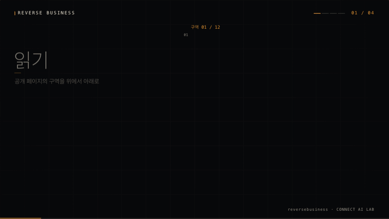
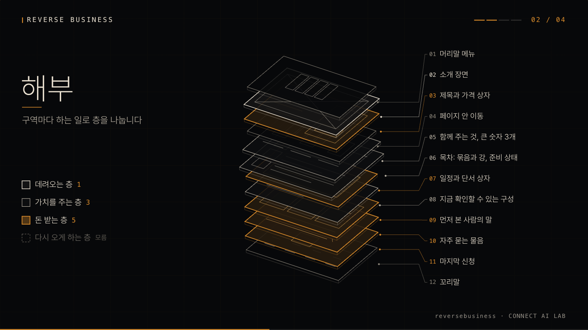
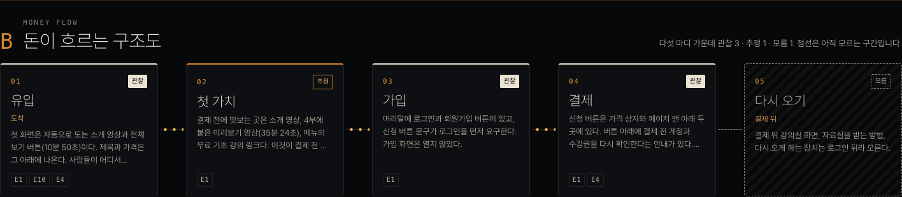
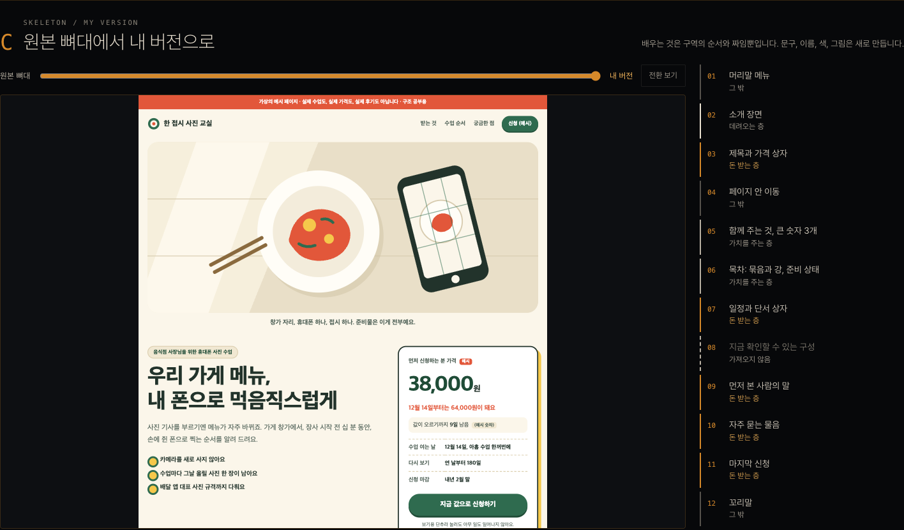
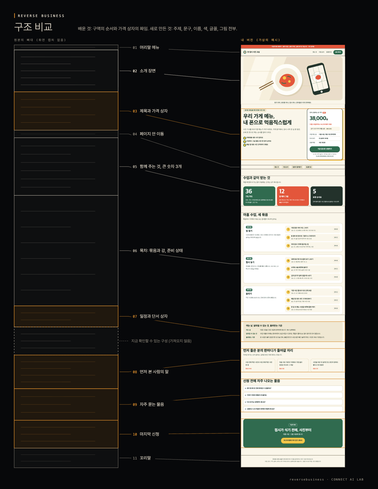

<p align="center">
  <b>CONNECT AI LAB · 모두를 위한 AI 교육</b><br>
  <a href="https://www.youtube.com/@CONNECT-AI-LAB">유튜브 CONNECT AI LAB</a> · <a href="https://www.aicitybuilders.com">강의 aicitybuilders.com</a>
</p>

# reversebusiness



**사업 웹사이트 주소 하나를 넣으면 그 사업을 해부합니다.** 누가 왜 돈을 내는지, 어디서 들어와 어디서 결제하는지, 페이지가 어떤 층으로 짜여 있는지를 확인된 만큼만 적고, 구조만 배워 내 버전을 새로 만듭니다. 원본을 그대로 복제하지 않습니다.

```bash
npx github:wonseokjung/reversebusiness
```

**한 줄이면 REA 와 reversebusiness 가 같이 깔립니다.** REA 는 페이지를 깊게 읽는 눈이고(원본 [morluto/rea](https://github.com/morluto/rea), 별개의 도구, MIT), reversebusiness 는 그 눈으로 본 것을 사업으로 정리합니다.

CONNECT AI LAB 오픈소스 1호. 의존성 0, Node 18 이상 (REA 까지 쓰려면 Node 22.19 이상, 24.11 이상, 26 이상).

[English below](#reversebusiness-english)

## 30초 따라 하기

1. 터미널에 위의 한 줄을 넣습니다. 이 컴퓨터의 에이전트(Claude Code, Codex, Gemini CLI, Cursor, Antigravity)를 찾아 바뀔 것을 보여 주고, 한 번 확인받은 뒤 reversebusiness 스킬을 설치합니다. REA 가 없으면 REA 도 함께 설치합니다 (확인을 받은 뒤에만 REA 의 공식 npm 패키지 `rea-agents` 를 내려받아 setup 을 부릅니다. 확인 전에는 아무것도 내려받지 않습니다).
2. 끝나자마자 브라우저에 해부 화면이 열리고 예시 해부가 재생됩니다.
3. 에이전트를 새로 시작하고 이렇게 말합니다.

   ```
   reversebusiness 로 <궁금한 사업의 주소> 를 해부해 줘
   ```

에이전트 없이 바로 보고 싶으면 주소를 붙입니다. 공개 페이지를 읽어 그 주소의 해부 화면을 엽니다. REA 가 있으면 세 깊이로 읽는 정밀 모드가 저절로 켜집니다.

```bash
npx github:wonseokjung/reversebusiness https://example.com
```

에이전트가 대신 실행할 때처럼 물어볼 사람이 없는 터미널에서는 `--yes` 를 붙여야 설치합니다. 붙이지 않으면 바뀔 것만 보여 주고 예시 화면을 엽니다.

| 옵션 | 하는 일 |
|---|---|
| `--yes` | 묻지 않고 설치 |
| `--dry-run` | 무엇이 바뀌는지만 보여 주기 |
| `--remove` | 이 도구가 설치한 스킬만 지우기 |
| `--no-open` | 브라우저를 열지 않고 화면 주소만 출력 |
| `--agent claude,codex` | 에이전트를 직접 고르기 (`claude`, `codex`, `cursor`, `gemini`, `antigravity`, `agents`) |
| `--no-rea` | REA 는 설치하지 않기 (가벼운 모드로 동작) |

Node 가 REA 가 받는 판보다 낮으면 REA 는 건너뛰고 까닭과 방법을 알려 줍니다. 우리 스킬은 그대로 설치되고 가벼운 모드로 동작합니다. REA 가 이미 있으면 건드리지 않습니다. `--remove` 는 reversebusiness 만 지우고 REA 는 지우지 않습니다.

## 세 깊이로 읽기: 겉, 흐름, 속

멈춰 있는 것(내려온 파일)과 움직이는 것(브라우저에서 실제로 일어나는 일)을 함께 봅니다. 사람이 브라우저의 개발자 도구를 열어 보는 것과 같은 일을, 선을 정해 두고 대신 합니다.

| 깊이 | 무엇을 하나 | 얻는 것 | 하지 않는 것 |
|---|---|---|---|
| 1. 겉 읽기 | 브라우저가 그린 화면의 글과 구조를 읽는다 | 가격, 누르는 곳, 구역의 뼈대, 저장소 키 이름 | 저장소와 쿠키의 값은 읽지 않는다 |
| 2. 흐름 읽기 (움직이는 것) | 펼치기만 누른다: 가격 탭, 자주 묻는 질문, 더 보기. 그동안 페이지가 요청을 보내려던 호스트 이름을 모은다 | 탭 안쪽의 가격, 결제사와 분석 도구와 영상 호스팅의 이름 | 폼 제출, 로그인, 가입, 결제, 구매 단추와 다른 페이지로 가는 링크는 누르지 않는다. 주고받은 내용, 쿠키, 토큰은 남기지 않는다 |
| 3. 속 읽기 (멈춰 있는 것) | 이미 내려온 스크립트를 실행 없이 읽는다 | 화면 경로 이름(로그인 뒤로 보이는 화면 포함), 결제 모듈 이름, 가격과 요금제처럼 보이는 글자 | 찾은 주소는 하나도 부르지 않는다. 이름만 적는다 |

- 속 읽기는 **약관이 서비스 코드 분석을 금지하면 하지 않고**, 리포트에 그 사실을 적습니다. 약관을 읽지 못했을 때도 하지 않습니다. 내 사이트면 `--own` 을 붙이면 합니다.
- 코드에서만 본 것은 관찰이 아니라 **코드 흔적**으로 따로 적습니다. 코드 안에 가격 숫자가 있어도 화면에서 확인되기 전에는 "지금 파는 가격"이라고 쓰지 않고, 검사기가 그렇게 쓴 리포트를 오류로 잡습니다.
- 어느 단계가 실패하거나 시간 한도를 넘으면 건너뛰고, 화면 맨 위의 "읽은 깊이"에 어디까지 읽었고 왜 멈췄는지 남깁니다.
- REA 가 없거나 `--light` 를 붙이면 겉 읽기만 합니다 (가벼운 모드).

## 네 단계

| 단계 | 하는 일 | 나오는 것 |
|---|---|---|
| 1. 읽기 | robots.txt 와 약관을 먼저 확인하고 공개 페이지에서 근거를 모은다 | 근거 장부, 초안 |
| 2. 해부 | 정해진 6칸을 채운다. 문장마다 관찰, 추정, 모름 가운데 하나가 붙는다 | `report.json`, 해부 화면 |
| 3. 내 버전 만들기 | 6번 칸의 명세만 보고 새로 만든다. 문구, 이름, 색, 그림은 전부 새로 | 내 버전 폴더 |
| 4. 검사 | 원본과 겹치는 문장, 이름, 그림 주소가 없는지 본다 | 통과 또는 겹친 곳 목록 |

2단계에서 멈추는 "해부만"도 됩니다. 그때 내 버전 칸은 비워 두고 `check --dissect-only` 로 검사하며, 화면에는 내 버전 자리에 "아직 만들지 않음"이라고 나옵니다.

6칸: 누가 왜 돈을 내는가 / 핵심 사용자 흐름 / 화면과 기능 지도 / 기술 구성 / 근거와 모르는 것 / 내 버전 명세.

## 해부 다음에 할 일

해부(`report.json`)가 끝나면 명령 한 줄씩으로 이어 갑니다. 명령마다 끝에 다음에 칠 명령이 한 줄로 나옵니다.

```
rebiz <주소>  ->  rebiz fill  ->  rebiz build 또는 rebiz apply  ->  rebiz view, rebiz video
```

| 하고 싶은 일 | 명령 | 하는 일 |
|---|---|---|
| 모름 칸 채우기 | `rebiz fill report.json` | 에이전트에게 붙여 넣을 한 문장을 줍니다. `--agent claude` 나 `--agent codex` 를 붙이면 확인을 받은 뒤 내 에이전트를 한 번 실행해, 이미 읽어 둔 자료만으로 채우고 검사 결과를 보여 줍니다 |
| 새 사이트 만들기 | `rebiz build report.json --topic "내 사업 주제"` | 6번 칸의 명세와 배운 구역의 순서만으로, 바로 열리는 정적 사이트의 출발점(`index.html`, `style.css`)을 만듭니다 |
| 내 프로젝트에 적용 | `rebiz apply report.json --to ./내-프로젝트` | 내 첫 화면을 배운 뼈대와 견주어 빈칸 목록을 표와 `rebiz-apply/plan.md` 로 남깁니다. `--agent` 를 붙이면 새 git 브랜치에서 에이전트가 고칩니다 |
| 영상 뽑기 | `rebiz video report.json` | 브라우저를 열지 않고 해부 영상(9:16, 1080x1920, 약 30초)을 파일로 저장합니다 |

- **build 가 쓰는 재료.** 6번 칸에 내 말로 쓴 명세, 뼈대의 구역 종류와 순서, 이 도구의 안내 문구와 중립 디자인(검정 바탕, 얇은 글꼴, 금색 강조)뿐입니다. 대상의 문구, 이미지, 이름, 색, 로고는 쓰지 않고, 문구 자리는 "여기에 무엇을 쓸지" 안내로 채웁니다. 가격, 숫자, 후기는 지어내지 않고 빈자리로 둡니다. 6번 칸이 비어 있으면 만들지 않고 채우는 방법을 알려 줍니다. 리포트 옆에 `source.json` 이 있으면 끝나고 겹침 검사를 스스로 돌려, 겹치면 종료 코드로 알립니다. 이미 파일이 있는 폴더는 `--force` 없이는 건드리지 않습니다.
- **apply 가 하는 일과 하지 않는 일.** 먼저 하는 것은 견주기뿐입니다: 대상에는 있는데 내 첫 화면에는 없는 구역, 순서가 다른 구역. 첫 화면은 프로젝트의 `index.html` 에서 찾고, 프레임워크 프로젝트라 찾지 못하면 그 사실을 말하고 `--page <파일>` 이나 `--url http://localhost:3000` 을 안내합니다 (`--url` 은 내 컴퓨터 주소만 받습니다). 코드를 고치는 일은 에이전트 몫입니다. `--agent` 를 붙였을 때만, 프로젝트가 git 저장소이고 작업 트리가 깨끗한지 확인하고(아니면 멈추고 까닭을 말합니다) 새 브랜치 `rebiz/apply-날짜` 를 만든 뒤에 맡깁니다. 끝나면 `git diff --stat` 과 바뀐 파일의 겹침 검사를 보여 줍니다. 커밋, push, 배포는 하지 않습니다.
- **에이전트에 맡기기(`--agent`)는 기본이 아닙니다.** 붙이지 않으면 붙여 넣을 한 문장만 줍니다. 붙이면 "이 단계는 내 에이전트를 한 번 실행하고, 그 에이전트의 사용량을 씁니다"를 보여 주고 한 번 확인받습니다(`--yes` 로 생략). 작업 폴더는 그 일의 폴더 하나입니다. Claude Code 는 `claude -p` 에 허용 도구를 읽기, 그 폴더 안 고치기, `rebiz check` 실행으로 좁혀 부르고, Codex 는 `codex exec --sandbox workspace-write` 로 부릅니다. 권한 확인을 건너뛰거나 샌드박스를 끄는 옵션은 쓰지 않습니다. 시간 한도는 fill 10분, apply 20분이고 `--timeout <분>` 으로 바꿉니다. 에이전트의 실행 파일이 없으면 붙여 넣을 한 문장으로 대신합니다.
- **video.** 이 컴퓨터의 Chrome, Chromium, Edge, Brave 가운데 하나를 임시 프로필의 헤드리스 창으로 띄워 해부 화면의 "영상으로 저장"을 대신 누릅니다. 바깥으로 나가는 요청은 없고, 끝나면 브라우저를 끄고 프로필을 지웁니다. 저장 형식은 브라우저가 정합니다(Chrome 에서는 mp4). 브라우저가 없으면 까닭과 대신 할 일을 알려 줍니다.

실제로 써 본 범위 (0.5.0, macOS, Node 20, Chrome): build, apply, video 는 예시 리포트와 지어낸 프로젝트로 끝까지 돌려 확인했습니다. Codex 에 맡기기는 `fill` 로 한 번 실행해 확인했습니다. Claude Code 에 맡기기는 넘기는 인자만 시험했고 실제 실행은 아직 확인하지 못했습니다.

## 해부 화면에서 보이는 것

한 파일짜리 HTML 이고 인터넷 없이 열립니다. 원본의 화면 캡처, 문구, 로고는 쓰지 않고 뼈대만 그립니다.

**해부 장면.** 페이지의 구역이 선으로 된 블록으로 나타나 층층이 벌어지고, 구역마다 역할이 붙습니다: 데려오는 층, 가치를 주는 층, 돈 받는 층, 다시 오게 하는 층.



**읽은 깊이.** 맨 위에 겉, 흐름, 속 가운데 어디까지 읽었고 왜 멈췄는지가 나옵니다.

**돈이 흐르는 구조도.** 유입, 첫 가치, 가입, 결제, 다시 오기. 마디마다 관찰, 추정, 모름과 근거 번호가 붙고, 모르는 구간은 점선으로 끊깁니다. 흐름에서 본 결제사와 분석 도구의 이름이 마디에 붙고, 화면 지도에는 코드에서만 이름이 보인 화면이 점선으로 나옵니다.



**원본 뼈대에서 내 버전으로.** 슬라이더를 밀면 뼈대가 내 버전 페이지로 바뀝니다.



**영상으로 저장.** 해부 과정을 9:16 (1080x1920) 약 30초 영상으로 브라우저에서 바로 저장합니다. 소리는 없습니다. 영상 저장이 안 되는 브라우저에서는 안내만 나옵니다. 화면을 열지 않고 뽑으려면 `rebiz video report.json`.

움직임 줄이기 설정을 따르고, 폰 너비에서도 볼 수 있습니다. 화면의 글자는 한국어와 영어를 바꿀 수 있습니다.

## 주소를 바로 읽을 때 지키는 것

`rebiz <주소>` 는 에이전트 없이 돕니다. 아래는 가벼운 모드와 정밀 모드 모두에 적용됩니다.

- robots.txt 를 가장 먼저 받습니다. 막혀 있으면 받지 않고 멈춥니다.
- 첫 페이지 한 장과 그 페이지에 걸린 가격, 약관, 환불 링크까지 최대 5장.
- 요청 사이 2초 이상. robots.txt 의 Crawl-delay 가 더 길면 그 값을 따르고, 60초보다 길면 멈춥니다.
- GET 만 합니다. 로그인, 가입, 결제, 폼 제출을 하지 않고, 그리로 가는 링크는 열지 않습니다.
- 찾은 주소를 부르지 않습니다. 코드나 화면에서 주소를 찾아도 이름만 적고, 열거나 호출해 보지 않습니다.
- 쿠키와 토큰을 저장하지도 보내지도 않습니다.
- **그려진 화면 읽기.** 요즘 사이트는 화면을 스크립트로 그려서 받은 HTML 에 글이 거의 없는 경우가 많습니다. 받은 글이 얇거나 정밀 모드이면 이 컴퓨터의 Chrome, Chromium, Edge, Brave 가운데 하나를 임시 프로필의 헤드리스 창으로 잠깐 띄워 그려진 화면을 한 번 읽습니다. 입력과 화면 캡처는 없고(누르는 것은 정밀 모드의 펼치기뿐), 브라우저 안에서 나가는 요청도 같은 선으로 거릅니다(GET 이 아닌 요청, robots.txt 가 막은 주소, 로그인과 결제 주소, 분석 도구는 보내지 않음). 끝나면 브라우저를 끄고 임시 프로필을 지웁니다. 해부 장면의 구역도 이때 실제 위치와 길이로 잽니다. `--no-render` 로 끌 수 있습니다.
- 누가 읽는지 숨기지 않습니다. User-Agent 에 이름과 이 저장소 주소가 들어갑니다.
- 401, 403, 429 나 사람 확인 화면을 만나면 넘지 않고 멈춥니다. 남은 링크도 받지 않습니다.
- 채울 수 있는 것만 관찰로 적고, 나머지는 모름으로 둡니다. 고객, 문제, 내 버전 같은 해석은 하지 않습니다.

정밀 모드에서 REA 는 이 임시 브라우저에 내 컴퓨터 안(127.0.0.1)의 주소로만 붙어서 읽습니다. 브라우저가 없으면 받은 HTML 만 읽고, 결과 끝과 화면 맨 위에 "읽은 글이 N자뿐이라 모름이 많다"와 다음에 할 일이 나옵니다. 그때는 REA 나 에이전트와 함께 채웁니다. 내 사이트를 읽을 때는 `--own` 을 붙입니다.

## 지켜야 할 선

배워도 되는 것은 기능, 흐름, 사업 구조입니다. 가져오면 안 되는 것은 코드, 문구, 이미지, 브랜드입니다. 스킬 본문 맨 위에 아래 여덟 가지가 적혀 있고, 에이전트는 어기는 요청을 거절합니다.

1. 로그인, 결제, 접근 제한을 넘지 않는다. 가짜 계정도 만들지 않는다.
2. 비공개 데이터를 모으지 않는다.
3. 대량으로 긁지 않는다. 사람이 읽는 속도로, 정해진 한도 안에서만.
4. 이용약관과 robots.txt 를 먼저 확인하고 리포트에 적는다.
5. 코드, 문구, 이미지, 아이콘, 로고를 복제하지 않는다.
6. 내 버전을 "○○ 클론"이라고 부르지 않는다. 대상의 이름을 내 이름에 넣지 않는다.
7. 추정은 추정이라고 표시한다. 모르는 것은 모름으로 둔다.
8. 매출, 사용자 수 같은 숫자는 공개된 근거가 있을 때만 적는다. 없으면 비운다.

검사기 두 개가 이 가운데 기계로 볼 수 있는 것을 잡습니다. 리포트 검사는 근거 없는 관찰, 출처 없는 수익 숫자, 빠진 단계, 대상 이름이 들어간 내 버전 이름을 잡고, 겹침 검사는 다섯 낱말 이상 연달아 같은 문장, 원본 이름과 도메인, 원본 그림 주소를 잡습니다. 색, 글꼴, 배치의 닮음은 사람이 두 화면을 나란히 놓고 봅니다.

이 도구의 결과는 공부와 기획을 위한 정리이며 법률 자문이 아닙니다.

## 대표 예시

CONNECT AI LAB 이 운영하는 aicitybuilders.com 의 공개 판매 페이지 한 장을, 남의 서비스와 같은 방식으로 밖에서 보이는 것만 읽었습니다. 문장 33개 가운데 관찰 20, 추정 6, 모름 7. 수익 숫자 칸은 비어 있습니다. 가격과 날짜는 2026-11-17 에 읽은 값입니다.



왼쪽은 원본의 뼈대, 오른쪽은 구조만 배워 새로 만든 가상의 예시 페이지입니다. 파일과 설명은 [examples/aicitybuilders-vibecoding](examples/aicitybuilders-vibecoding) 에 있습니다.

## 설치되는 곳

하는 일은 폴더 복사 하나입니다. 에이전트의 설정 파일은 건드리지 않습니다. 같은 이름의 다른 폴더가 있으면 건너뛰고, 지울 때는 설치 때 남긴 표식 파일이 있는 폴더만 지웁니다.

| 에이전트 | 스킬이 놓이는 곳 | 실제로 써 본 결과 (0.3.0, macOS) |
|---|---|---|
| Claude Code | `~/.claude/skills/reversebusiness` | 확인. 스킬을 불러와 수집, 검사, 화면까지 끝남 |
| Codex | `~/.agents/skills/reversebusiness` | 확인. 공용 폴더에서 읽어 끝까지 끝남 |
| Antigravity | `~/.gemini/config/skills/reversebusiness` | 스킬 인식과 내용 읽기는 확인. 도구를 돌리려면 명령 실행을 허용해야 함 (자동 실행에서는 권한이 없어 못 돌림, 대화형은 미확인) |
| Cursor | `~/.agents/skills/reversebusiness` (Codex 와 같은 공용 폴더) | 미확인. 문서에 적힌 위치를 따름 |
| Gemini CLI | `~/.agents/skills/reversebusiness` (같은 공용 폴더) | 미확인. 문서에 적힌 위치를 따름 |
| 직접 지정 | `--dir <스킬 폴더>`, 또는 `--project` (지금 폴더의 `.claude/skills`) | |

## 명령 모음

```bash
rebiz                                   # 설치(REA 가 없으면 함께, --no-rea 로 건너뜀) + 예시 해부 화면
rebiz <주소>                            # 그 주소를 바로 해부 (--own, --light, --no-render, --out <폴더>, --pages 1~5)
rebiz demo                              # 예시 해부 화면만
rebiz view report.json --mine ./my-version   # 리포트를 해부 화면으로 (내 버전 미리보기 포함)
rebiz check report.json                 # 리포트 검사 (해부만 했으면 --dissect-only)
rebiz clone-check ./my-version --source source.json   # 내 버전이 원본과 겹치는지
rebiz draft <REA 근거 JSON ...>         # REA 로 모은 근거에서 초안 만들기
rebiz fill report.json                  # 모름 칸 채우기: 붙여 넣을 한 문장 (--agent claude|codex 로 한 번 맡기기)
rebiz build report.json                 # 새 사이트의 출발점 만들기 (--out <폴더>, --topic "내 사업 주제", --force)
rebiz apply report.json --to ./내-프로젝트   # 내 첫 화면과 견준 빈칸 목록 (--page <파일>, --url http://localhost:3000, --agent claude|codex)
rebiz video report.json                 # 해부 영상(9:16)을 파일로 (--out <파일>, --mine <내 버전 폴더>)
rebiz --remove                          # 지우기 (REA 는 지우지 않음)
```

`fill`, `build`, `apply`, `video` 는 리포트 파일을 주지 않으면 지금 폴더의 `report.json` 을 씁니다.

`rebiz` 자리에 `npx github:wonseokjung/reversebusiness` 를 쓰면 설치 없이 같은 명령이 됩니다. 에이전트가 채운 리포트를 고칠 때는 `report.json` 을 직접 고친 뒤 `check` 를 다시 돌립니다. `source.json`, `requests.json`, `evidence/` 폴더에는 원본의 글과 요청 기록이 들어 있으므로 공개 장소에 올리지 않습니다.

## REA 위에서 쓰는 별개의 도구

[REA: Reverse Engineer Anything](https://github.com/morluto/rea) (MIT License, Copyright (c) 2026 morluto) 는 원본이고 별개의 도구입니다. reversebusiness 는 REA 를 포크하지 않았고, REA 의 코드와 문구를 담고 있지 않습니다. REA 프로젝트가 만들거나 보증한 배포물이 아닙니다.

- REA 는 앱, 웹 페이지, 네트워크 캡처를 분석 엔진에 연결하는 도구입니다. reversebusiness 는 REA 를 눈으로 써서 공개 자료로 사업을 읽는 절차, 6칸 리포트, 해부 화면, 검사기를 더합니다.
- 함께 설치할 때는 REA 의 공식 npm 패키지 이름 `rea-agents` 로만 부릅니다 (`npx -y rea-agents@latest setup`). 이름이 비슷한 다른 패키지나 다른 주소에서 받지 않습니다. 에이전트 설정에 REA 연결을 더하는 것은 REA 의 setup 이고, 무엇을 바꿀지는 설치 전에 화면에 나옵니다.
- REA 가 없어도 가벼운 모드로 같은 절차를 시작할 수 있습니다.
- REA 를 쓸 때는 REA 의 책임 있는 사용 안내도 함께 따릅니다. REA 까지 지우려면 `npx -y rea-agents@latest uninstall`.

## 개발과 시험

```bash
npm test                     # 설치기, 수집기, 검사기, 정밀 모드, 해부 다음 명령 시험 (임시 HOME, 임시 git 저장소, 내 컴퓨터의 시험용 사이트, REA 와 에이전트는 대역)
node bin/rebiz.mjs --dry-run
```

시험한 환경은 macOS, Node 20, Chrome 입니다. 그려진 화면 읽기 시험은 Chrome 계열 브라우저가 없으면 건너뜁니다. Windows 와 Linux 에서는 아직 시험하지 못했습니다. 기여 방법은 [CONTRIBUTING.md](CONTRIBUTING.md), 에이전트가 읽는 안내는 [AGENTS.md](AGENTS.md), 문제 신고는 [SECURITY.md](SECURITY.md) 에 있습니다.

## 라이선스

MIT License. Copyright (c) 2026 CONNECT AI LAB. [LICENSE](LICENSE)

---

# reversebusiness (English)

**Put in one business website URL and it dissects that business.** It records who pays and why, where people arrive and where they pay, and how the page is layered, only as far as it was confirmed. Then you build your own version from the structure alone. It does not copy the original.

```bash
npx github:wonseokjung/reversebusiness
```

**One line installs REA and reversebusiness together.** REA is the eye that reads a page in depth (the original, a separate tool: [morluto/rea](https://github.com/morluto/rea), MIT); reversebusiness turns what it sees into a business reading.

Open source no. 1 from CONNECT AI LAB. Zero dependencies, Node 18 or later (REA itself needs Node 22.19+, 24.11+ or 26+). The skill text and terminal output are in Korean; the dissection view has a Korean and English label switch.

## Thirty seconds

1. Run the line above. It finds the agents on this machine (Claude Code, Codex, Gemini CLI, Cursor, Antigravity), shows what will change, and after one confirmation installs the skill. If REA is missing it installs REA too, by calling the setup of REA's npm package `rea-agents`, after showing the plan REA itself reports. `--no-rea` skips that.
2. Your browser opens the dissection view and plays an example.
3. Restart your agent and say: `Use reversebusiness to dissect <URL>`.

Without an agent, add a URL. When REA is present the precise mode turns on by itself:

```bash
npx github:wonseokjung/reversebusiness https://example.com
```

In a terminal with nobody to ask (for example when an agent runs the command), it installs only with `--yes`. Other options: `--dry-run`, `--remove`, `--no-open`, `--agent claude,codex,cursor,gemini,antigravity,agents`.

## Four steps

| Step | What happens | Output |
|---|---|---|
| 1. Read | Check robots.txt and the terms first, then collect evidence from public pages | evidence ledger, draft |
| 2. Dissect | Fill six fixed cells. Every statement is tagged observed, inferred or unknown | `report.json`, dissection view |
| 3. Build my version | Build from the cell 6 spec only. Copy, names, colors and images are all new | your version |
| 4. Check | Look for shared sentences, names and asset URLs | pass, or a list of overlaps |

## After the dissection

Once `report.json` exists, each next step is one command, and every command ends with the next line to type: `rebiz <URL>` -> `rebiz fill` -> `rebiz build` or `rebiz apply` -> `rebiz view`, `rebiz video`.

| Goal | Command | What it does |
|---|---|---|
| Fill the unknowns | `rebiz fill report.json` | Prints one sentence to paste into your agent. With `--agent claude` or `--agent codex` it asks once, runs your agent once on the material already collected, then shows the check result |
| Start a new site | `rebiz build report.json --topic "my business"` | Writes a static starting point (`index.html`, `style.css`) from the cell 6 spec and the learned section order only |
| Apply to my project | `rebiz apply report.json --to ./my-project` | Compares your first screen with the learned skeleton and writes the gaps as a table and `rebiz-apply/plan.md`. With `--agent`, your agent edits on a new git branch |
| Export the video | `rebiz video report.json` | Saves the 9:16 dissection video (1080x1920, about 30 seconds) without opening a browser window |

- **build** uses only the spec you wrote in cell 6, the kinds and order of the learned sections, and this tool's own guidance text and neutral design. No copy, images, names, colors or logos of the target. Copy slots say what to write there; prices, numbers and testimonials are left empty, never invented. With an empty cell 6 it builds nothing and tells you how to fill it. When `source.json` sits next to the report it runs the overlap check by itself and exits non-zero on overlap. A folder that already has files is left alone unless `--force` is given.
- **apply** first only compares: sections the target has and your first screen lacks, and sections in a different order. It looks for `index.html`; for a framework project it says so and points to `--page <file>` or `--url http://localhost:3000` (local addresses only). Editing code is the agent's job. Only with `--agent` does it check that the project is a git repository with a clean working tree (otherwise it stops and says why), create the branch `rebiz/apply-YYYYMMDD`, and hand over. Afterwards it shows `git diff --stat` and runs the overlap check on the changed files. It never commits, pushes or deploys.
- **Delegating (`--agent`) is not the default.** Without it you get a sentence to paste. With it, the tool states that the step runs your agent once and uses that agent's quota, and asks once (`--yes` skips the question). The working folder is the one folder of that job. Claude Code is called as `claude -p` with a narrow allowed tool list (read, edit inside that folder, run `rebiz check`); Codex as `codex exec --sandbox workspace-write`. Options that skip permission checks or turn the sandbox off are never used. Time limits are 10 minutes for fill and 20 for apply (`--timeout <minutes>`). When the agent CLI is missing, the paste sentence is the fallback.
- **video** opens a headless Chrome, Chromium, Edge or Brave with a throwaway profile and presses the view's own save button. Nothing leaves the machine, and the browser is closed and the profile deleted afterwards. The browser decides the format (mp4 in Chrome). Without a browser it says why and what to do instead.

Tried in real use (0.5.0, macOS, Node 20, Chrome): build, apply and video end to end with the example report and a made-up project; delegation to Codex once with `fill`. Delegation to Claude Code is covered by argument tests only and has not been run for real yet.

## What the view shows

A single HTML file that works offline. It never uses screenshots, copy or logos of the original, only wireframes.

- **Dissection scene**: page sections appear as wire blocks and pull apart into layers labeled attract, value, pay and return.
- **Money flow**: arrive, first value, sign-up, payment, return. Each step carries its status and evidence numbers. Unknown links are dashed.
- **Skeleton to my version**: a slider turns the wireframe into your own page.
- **Save as video**: the dissection as a 9:16 (1080x1920) video of about 30 seconds, saved in the browser. No sound. Browsers that cannot record show a notice instead. `rebiz video report.json` does the same without opening a window.

It respects the reduced motion setting and works at phone width.

## Three depths: surface, flow, code

Static and dynamic reading together, the way a person would look with the browser's developer tools, but inside fixed limits.

| Depth | What it does | What you get | What it never does |
|---|---|---|---|
| 1. Surface | Reads the text and structure of the page as drawn by a browser | prices, actions, the section skeleton, storage key names | reads no storage or cookie values |
| 2. Flow (dynamic) | Clicks only things that expand: pricing tabs, FAQ items, "more". Collects the host names the page tried to contact | prices inside tabs, names of payment, analytics and video providers | no form submission, login, sign-up, payment or purchase buttons, no links to other pages; no bodies, cookies or tokens are kept |
| 3. Code (static) | Reads the scripts that were already downloaded, without running them | screen route names (including ones that look like they sit behind login), payment module names, price-like and plan-like strings | never calls any address it finds; it writes down names only |

The code depth is skipped when the terms forbid analyzing the service's code, or when the terms could not be read; `--own` enables it for your own site. Anything seen only in code is recorded as a **code trace**, not as observed: a price found in code is never written as the current price, and the checker rejects reports that do. Without REA, or with `--light`, only the surface is read.

## What reading a URL keeps to

robots.txt first, and it stops if the URL is disallowed. One page plus pricing, terms and refund links, five pages at most. Two seconds or more between requests, or the site's Crawl-delay when it is longer (it stops if that is over 60 seconds). GET only: no login, sign-up, payment or form submission, and links that lead there are not opened. No cookies or tokens are stored or sent. When the received HTML is thin (most script-drawn sites), it opens the page once in a headless Chrome, Chromium, Edge or Brave with a throwaway profile and reads the drawn page: no input, no screenshots, no clicks outside the precise mode's expanding clicks, and requests leaving the browser are filtered by the same rules (non-GET requests, robots-disallowed URLs, login and checkout URLs and analytics are not sent). The browser is closed and the profile deleted afterwards. `--no-render` turns this off; `--own` marks the target as your own site. The User-Agent names the tool and this repository. It stops at 401, 403, 429 and human-check pages. Only what it can see is written as observed; everything else stays unknown.

## Lines we do not cross

Functions, flows and business structure may be studied. Code, copy, images and brand may not be taken.

1. No bypassing logins, payments or access limits. No fake accounts.
2. No collecting non-public data.
3. No bulk crawling. Human reading speed, within fixed limits.
4. Check the terms of service and robots.txt first, and record the result.
5. No copying code, copy, images, icons or logos.
6. Never call your version an "X clone", and never put the target's name in yours.
7. Mark inferences as inferred. Leave unknowns as unknown.
8. Revenue and user numbers only with a public source. Otherwise leave them empty.

The output is a study and planning note, not legal advice.

## Example

One public sales page of aicitybuilders.com, run by CONNECT AI LAB, read from the outside exactly as a third-party service would be. Of 33 statements, 20 are observed, 6 inferred and 7 unknown. The revenue cell is empty. Prices and dates are values read on 2026-11-17. See [examples/aicitybuilders-vibecoding](examples/aicitybuilders-vibecoding).

## Where the skill goes

Setup only copies a folder and never edits an agent configuration file: `~/.claude/skills/reversebusiness` for Claude Code, `~/.agents/skills/reversebusiness` shared by Codex, Cursor and Gemini CLI, and `~/.gemini/config/skills/reversebusiness` for Antigravity. Tried in real use on macOS: Claude Code and Codex ran end to end; Antigravity lists and reads the skill but needs command execution allowed to run the tools; Cursor and Gemini CLI are untested. `--remove` deletes only folders that carry the marker file written at install time.

## A separate tool that works on top of REA

[REA: Reverse Engineer Anything](https://github.com/morluto/rea) (MIT License, Copyright (c) 2026 morluto) is the original and a separate tool. reversebusiness is not a fork of REA and contains no REA code or text. It is not made or endorsed by the REA project. When it installs REA alongside itself it only ever calls REA's npm package by its name `rea-agents` (`npx -y rea-agents@latest setup`), never a similarly named package or another address; the changes to agent configuration are made by REA's own setup and are shown before anything is applied. Without REA the light mode starts the same procedure. Follow REA's responsible use notice when you use it. `--remove` removes reversebusiness only; to remove REA as well run `npx -y rea-agents@latest uninstall`.

## License

MIT License. Copyright (c) 2026 CONNECT AI LAB. See [LICENSE](LICENSE).

<p align="center">
  <b>CONNECT AI LAB · 모두를 위한 AI 교육</b><br>
  <a href="https://www.youtube.com/@CONNECT-AI-LAB">YouTube CONNECT AI LAB</a> · <a href="https://www.aicitybuilders.com">aicitybuilders.com</a>
</p>
